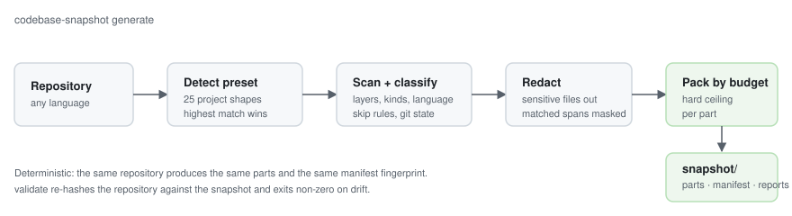

# codebase-snapshot

**Turn any repository into an LLM-ready snapshot: code packed into size-budgeted markdown
parts, indexed by a JSON manifest, with a secret audit — in one command.**

[](https://www.npmjs.com/package/@ankurhalder/codebase-snapshot)
[](https://www.npmjs.com/package/@ankurhalder/codebase-snapshot)
[](LICENSE)
[](https://nodejs.org)

```bash
npx @ankurhalder/codebase-snapshot generate
```

That writes `./snapshot/` — a directory you can drop into a chat, a prompt, a RAG pipeline or
a repository review. It works on TypeScript and JavaScript projects, and on Python, Go, Rust,
Java/Kotlin, C#/.NET, PHP, Ruby, C/C++, Vue, Svelte and Astro, without configuration.



---

## Why

Feeding a real repository to a model is awkward: files are too big, context windows are too
small, and picking what matters by hand does not scale or repeat. `codebase-snapshot` does it
deterministically:

- **One file per part, never over budget.** `maxPartBytes` is a hard ceiling. A file bigger
  than the budget is truncated with an explicit omission marker naming the budget rather than
  blowing the limit — and above `largeFileBytes` it becomes a head/tail excerpt instead.
- **An index, not just text.** `manifest.json` lists every included file with its layer, kind,
  language, part, hash and a structural summary — and every *excluded* file with the reason.
- **Provably current.** `validate` re-hashes the repository against the snapshot and exits
  non-zero on any drift, so a pipeline can gate on context being fresh.
- **Deterministic where it matters.** Two runs over unchanged input give byte-identical
  `parts/`, `reports/navigation.md` and `reports/project-tree.md`, and the same
  `manifest.fingerprint`. Only `manifest.json`, the snapshot's `README.md`,
  `reports/audit.md` and `.codebase-snapshot` change between runs, because they carry
  timestamps, a run id and a pid.
- **Safe by default.** Credential files are skipped unless asked for, secret-shaped strings are
  redacted, and a mistyped output directory cannot delete source code.
- **Usable by agents, not just humans.** A machine-readable contract and an installable skill
  let an agent with no prior knowledge drive the whole thing.

## Install

```bash
npx @ankurhalder/codebase-snapshot generate      # no install, one-off
npm install -D @ankurhalder/codebase-snapshot    # or add it to a project
```

Any npm-compatible client works — npm, yarn (classic and Berry with strict PnP), pnpm and bun —
each verified against the packed tarball before release. Requires **Node.js 18+**.

→ [Installation guide](docs/install.md)

## Quick start

One command does the whole first run — detects the project, writes a commented config, adds the
npm scripts and the devDependency, installs it, and generates the snapshot:

```bash
npx @ankurhalder/codebase-snapshot setup
```

```bash
# Or step by step, if you want to see each stage:
npx @ankurhalder/codebase-snapshot init --yes   # config + scripts + devDependency + .gitignore
npm install                                     # the package, into node_modules
npm run snapshot                                # generate
npm run snapshot:validate                       # exit 0 = current with disk
```

`setup` keeps a config the repository already has, and `setup --no-install` skips the install
(CI, offline, or a lockfile you would rather not touch).

```
📸 Generating snapshot for: /Users/you/project
   Branch: main | Part budget: 300 KB

✅ Snapshot generated in 0.14s:
   - Tracked files: 128
   - Total lines:   9,431
   - Total size:    0.41 MB
   - Parts written: 3 under snapshot/parts/
   - Reports:       snapshot/reports/ (project-tree, navigation, audit)
   - Manifest:      snapshot/manifest.json
   - Fingerprint:   e4607b570268c8def0911babbace97e4a0196d9eaf2cac22c8847500883d70aa
   - Integrity:     passed
```

The fingerprint is printed in full — all 64 hex characters, never elided — and it is the same
value as `manifest.fingerprint`.

## What you get

```
snapshot/
├── README.md                  human summary of this snapshot
├── manifest.json              machine index: files, parts, hashes, config, skips
├── parts/part-001.md …        the code, grouped and size-budgeted
└── reports/
    ├── project-tree.md        directory tree of included files
    ├── navigation.md          links between layers, kinds and parts
    └── audit.md               secrets, large files, parse diagnostics, git state
```

Every artifact can be turned off (`--skip-artifacts`, `--only-artifacts`, or the config).

→ [Snapshot output and manifest schema](docs/output.md)

## Built to be trusted with a whole repository

A snapshot is only useful if you can believe it, so the tool is explicit about everything it does
*not* contain:

- **Nothing is dropped silently.** Every excluded path is recorded in `manifest.skipped[]` with a
  reason — `binary`, `gitignore`, `default-ignore`, `sensitive-file`, `sensitive-path`, `symlink`,
  `outside-root`, `read-error`, `not-file`, `nested-repository`, `excluded` — and `explain <path>`
  answers the same question for any single path.
- **Encoding is stated, not guessed.** UTF-16 files are transcoded instead of vanishing as
  "binary"; a file that is not valid UTF-8 is kept but labelled `utf-8-lossy` with the count of
  undecodable bytes, so you never mistake mojibake for source.
- **Counts describe what was emitted.** `includedBytes` and `includedLines` are measured from the
  block in the part, not from the file on disk.
- **Drift is checked, not assumed.** `validate` compares every file's hash *and* a digest of the
  settings the snapshot was generated with, so a changed budget, layer rule or secret pattern is
  drift rather than silence.
- **Memory is bounded.** Files above 2 MB are not parsed for a structural summary (that is where a 50 MB file
  used to reach 3 GB of resident memory), and 130 000 files in one directory or a 3 000-level path
  scan without crashing.
- **`diff` compares payloads, not just paths.** Two snapshots of identical sources with different
  settings say so instead of reporting "0 changed".
- **When git cannot list files** — an interrupted clone, a dehydrated `.git`, `safe.directory` —
  the run refuses rather than quietly scanning something different, and `--discovery walk` is the
  documented escape hatch.

## Supported projects

25 presets, detected automatically from the repository — each contributing layers, kinds,
ecosystem ignore patterns and a recommended part budget.

| | | | |
| :--- | :--- | :--- | :--- |
| Next.js | Nuxt | SvelteKit | Remix |
| Astro | Angular | Solid | Vue + Vite |
| React + Vite | NestJS | Express / Fastify / Koa | Node library |
| Monorepo | Django | FastAPI / Flask | Python library |
| Go | Rust | Java / Spring | .NET |
| Laravel (PHP) | Rails (Ruby) | Terraform / Docker infra | Docs-only |
| generic fallback | | | |

Non-TypeScript languages get import/export/class/function summaries rather than being treated
as opaque text. Vue, Svelte and Astro script blocks go through the real TypeScript compiler.
Every summary is labelled `ast`, `structural` or `heuristic` so you know how much to trust it —
Python, for example, is a line-scan `heuristic`, while JSON and Markdown get `structural`
shapes.

→ [Preset table and detection rules](docs/configuration.md#project-presets)

## Commands

| Command | Does |
| :--- | :--- |
| `generate` *(default)* | Write the snapshot. |
| `validate` / `check` | Compare the snapshot with the repository; exit `1` on drift. |
| `report` | Snapshot health, layer metrics, secret audit. |
| `init` | Interactive (or `--yes`) setup that writes a self-documenting config. |
| `explain <path>` | Why one path is included, which part it lands in, or why it was skipped. |
| `diff <a> <b>` | Compare two snapshots. |
| `describe` | The machine-readable contract (`--format json`). |
| `skill` | Print or install the agent skill. |

Exit codes: `0` success · `1` drift or refused generation · `2` usage error.

→ [Full CLI reference](docs/cli.md)

## For AI agents

Everything an agent needs is available as data, and the tool can install its own skill:

```bash
# The contract: workflow, every option and default, exit codes, presets, safety rules
npx @ankurhalder/codebase-snapshot describe --format json

# Install the skill into the registries agent tools read: .claude/skills/, .cursor/rules/
# (it adds those files to .gitignore, and never touches your own AGENTS.md)
npx @ankurhalder/codebase-snapshot skill --install
```

An agent told only "use `npx @ankurhalder/codebase-snapshot`" can read the contract, follow its
ordered workflow, and produce a validated snapshot unaided — that path is covered by a test.

→ [Using this with an AI agent](docs/agent.md) · [AGENTS.md](https://github.com/ankurhalder/codebase-snapshot/blob/main/AGENTS.md) · [llms.txt](https://github.com/ankurhalder/codebase-snapshot/blob/main/llms.txt)

## Configuration

`snapshot.config.ts` (or `.mjs`) is written by `init` with **every** setting at its current
value, commented and grouped, so it doubles as the reference. Deleting any line is safe: the
defaults are real. The object is exported through a name — `export default { … }` is
`import/no-anonymous-default-export`, on by default in `eslint-config-next`.

```js
const config = {
  maxPartBytes: "120k",                                   // hard budget per part
  excludePatterns: ["vendor/**", "**/*.min.js"],
  artifacts: { monolith: false },                         // single-file output stays off
  budgets: { default: "120k", byLayer: { docs: 40_000 } },
  includeSensitiveFiles: false,                           // .env, *.pem … stay out
};

export default config;
```

→ [Configuration reference](docs/configuration.md)

## Programmatic API

```js
import { generateSnapshot, resolveConfig, validateSnapshot, loadConfigFile } from "@ankurhalder/codebase-snapshot";

// Pass the repository explicitly: loadConfigFile returns only the config it found, so a
// directory with no config file would leave resolveConfig scanning process.cwd() instead.
const dir = "/path/to/repo";
const config = resolveConfig(await loadConfigFile(dir), { cwd: dir });
const manifest = generateSnapshot(config);
const validation = validateSnapshot(config);
```

CommonJS works too (`require("@ankurhalder/codebase-snapshot")`), with type definitions for
both. The CLI and the API share one implementation, so anything the CLI does is available here.

## Documentation

| | |
| :--- | :--- |
| [Installation](docs/install.md) | Every client, version pinning, agent skill install |
| [CLI reference](docs/cli.md) | Commands, options, exit codes, examples |
| [Configuration](docs/configuration.md) | Every setting, all 25 presets, budgets, hooks, secrets |
| [Snapshot output](docs/output.md) | Directory layout and the full manifest schema |
| [AI agents](docs/agent.md) | The contract, the skill, what an agent should avoid |
| [Troubleshooting](docs/troubleshooting.md) | Every message and what to do about it |
| [Changelog](CHANGELOG.md) | Release history and breaking changes |
| [Wiki](https://github.com/ankurhalder/codebase-snapshot/wiki) | Guides, recipes, FAQ |

## Safety

- **Credential files are excluded by default** — `.env`, `*.pem`, `*.key`, `.npmrc`, `.netrc`,
  `.git-credentials`, `id_rsa`, `.kube/config`, `*.tfstate` — and listed in
  `manifest.skipped[]` with the reason.
- **Secrets are redacted** inside ordinary files: only the matched span is masked, never the
  whole line, and no excerpt reaches any artifact.
- **The output directory is owned by the tool.** Each run is written to a scratch directory and
  swapped in atomically; the previous snapshot survives a failure.
- **It refuses to replace a directory it did not create**, so `--out-dir src` cannot destroy
  source code.

## Contributing

Issues and pull requests are welcome — see [CONTRIBUTING.md](https://github.com/ankurhalder/codebase-snapshot/blob/main/CONTRIBUTING.md) and the
[code of conduct](https://github.com/ankurhalder/codebase-snapshot/blob/main/CODE_OF_CONDUCT.md). Security reports: [SECURITY.md](SECURITY.md).

## License

[MIT](LICENSE) © Ankur Halder
